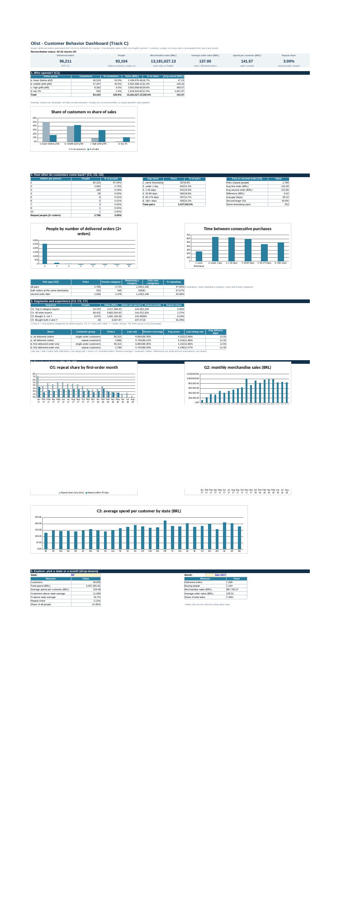

# Olist Customer Behavior — SQL + Excel BI Project (Track C)

How much do customers spend, how often do they come back, and what experience do they have?
This project answers 12 business questions on the public **Olist Brazilian E-Commerce** dataset with **T-SQL (SQL Server)** and presents the results in an **Excel dashboard**.



> The screenshot is a preview. The editable workbook is `excel/Track_C_Delivery_Dashboard.xlsx`.

## Headline results

Window: orders purchased **2017-01-01 to 2018-08-31**, delivered orders only (unless stated).

| Delivered orders | People | Merchandise sales | Avg order value | Repeat customers |
|---|---|---|---|---|
| 96,211 | 93,104 | 13,181,027.13 BRL | 137.00 BRL | 2,789 (3.00%) |

- The top 10% of customers generate **41%** of sales.
- Only **3.00%** of customers bought more than once in the window; the median gap between purchases is **29 days**.
- The drop in repeat share in recent months is mostly a **time effect**: the 90-day repeat share is much flatter.

Full answers, key findings and recommendations: [`report/Track_C_Findings.pdf`](report/Track_C_Findings.pdf).

## Repository structure

```
.
├── README.md
├── sql/
│   ├── 01_schema.sql              # database, staging import, typed tables, row-count check
│   ├── 02_validation.sql          # data-quality checks, PK/FK, analysis views
│   ├── 03_analysis.sql            # answers to the 12 questions (G1-G3, C1-C7, O1-O2)
│   └── 04_dashboard_exports.sql   # 12 export queries used by Excel
├── results/                       # aggregate CSV outputs of 04_dashboard_exports.sql
├── excel/
│   └── Track_C_Delivery_Dashboard.xlsx
├── report/
│   └── Track_C_Findings.pdf
├── docs/
│   ├── Track_C_Schema_Data_Dictionary.md   # ER diagram, fields, keys, grains, units
│   ├── Track_C_SQL_Coverage_Map.md         # SQL topic -> question -> script location
│   ├── Research_Answers_and_Evidence.md    # 12 answers, query refs, result tables, limitations
│   └── dashboard_screenshot.png
└── data/                          # NOT included: place the 8 Olist CSV files here locally
```
## Data

**Dataset:** Brazilian E-Commerce Public Dataset by Olist (Kaggle)  
**Source:** https://www.kaggle.com/datasets/olistbr/brazilian-ecommerce  
**License:** see the dataset page (CC BY-NC-SA 4.0 at the time of writing)  
**Period used in this project:** orders purchased 2017-01-01 to 2018-08-31  
**Size:** 8 CSV files, 99,441 orders (before filtering)

The raw CSV files are **not stored in this repository** (license and size). To reproduce the project:

1. Download the dataset from the Kaggle link above.
2. Put these 8 files in one folder, for example `C:\olist_raw\`:

| File | Rows | Content |
|---|---|---|
| `olist_customers_dataset.csv` | 99,441 | customers and location |
| `olist_orders_dataset.csv` | 99,441 | orders, status, dates |
| `olist_order_items_dataset.csv` | 112,650 | items, price, freight |
| `olist_order_payments_dataset.csv` | 103,886 | payments |
| `olist_order_reviews_dataset.csv` | 99,224 | review scores and comments |
| `olist_products_dataset.csv` | 32,951 | products and category |
| `olist_sellers_dataset.csv` | 3,095 | sellers and location |
| `product_category_name_translation.csv` | 71 | category names in English |

3. Set the folder path in `sql/01_schema.sql` (`@DataPath`) and run the scripts in order (see below).

Do not open and re-save the files in Excel; this can change line endings and quotes.

The files in `results/` are **aggregate outputs** of the SQL queries (no customer-level data).
## How to reproduce

**Requirements:** SQL Server 2017 or newer, SSMS, permission to run `BULK INSERT`, Excel.

Run the scripts **in this order** (each file states its purpose and run order at the top):

| Step | Script | What it does | Check |
|---|---|---|---|
| 1 | `sql/01_schema.sql` | Creates `OlistBI`, loads the CSVs into `stg.*`, builds typed `dbo.*` tables | All 8 row-count checks `PASS` |
| 2 | `sql/02_validation.sql` | Validates the data, adds 8 PKs and 6 FKs, creates the analysis views | 8 PK + 6 FK trusted; Part 5-C totals match |
| 3 | `sql/03_analysis.sql` | Answers the 12 questions; creates `vw_customer_summary` | Compare with the `Expected` comment of each question |
| 4 | `sql/04_dashboard_exports.sql` | Produces the 12 tables for Excel | Save each result as the CSV named in its header |

**Before step 1:** edit one line in `01_schema.sql` (section 3):

```sql
DECLARE @DataPath NVARCHAR(400) = N'C:\olist_raw\';  -- must end with \
```

The SQL Server service account must be able to read that folder.

### Reconciliation values (step 2, Part 5-C)

| Check | Expected |
|---|---|
| Orders in window | 99,092 |
| Delivered orders | 96,211 |
| Merchandise sales | 13,181,027.13 BRL |
| Freight | 2,192,092.88 BRL |
| Payments | 15,375,875.44 BRL |

## Questions answered

| ID | Question |
|---|---|
| G1 | How many orders are there, and what is their status? |
| G2 | How do sales change from month to month? |
| G3 | Which delivered orders lack a review or a payment? |
| C1 | How much do different customers spend? |
| C2 | How many customers purchase more than once, and how long do they wait? |
| C3 | Which customers spend more than their state average? |
| C4 | Do buyers of popular categories behave differently? |
| C5 | Who bought category X but not category Y? |
| C6 | How do the first two purchases compare? |
| C7 | Do single-order and repeat customers have different experiences? |
| O1 | Does repeat share depend on when a person first bought? |
| O2 | Is the second order in a category already bought? |

Where each answer lives: [`docs/Track_C_SQL_Coverage_Map.md`](docs/Track_C_SQL_Coverage_Map.md).

## Dashboard

The workbook contains the dashboard, SQL-derived source tables (`results/*.csv`), definitions and refresh notes, and a KPI reconciliation to the SQL totals.

| Export | File | Question |
|---|---|---|
| EXP_01 | `kpi_overview.csv` | G1, C1, C2 (KPI cards) |
| EXP_02 | `c1_value_groups.csv` | C1 |
| EXP_03 | `c2_orders_per_person.csv` | C2 |
| EXP_04 | `c2_gap_bands.csv` | C2 |
| EXP_05 | `c3_state_summary.csv` | C3 (state filter) |
| EXP_06 | `c4_segments.csv` | C4 |
| EXP_07 | `c5_segments.csv` | C5 |
| EXP_08 | `c6_first_two.csv` | C6 |
| EXP_09 | `c7_experience.csv` | C7 |
| EXP_10 | `o1_cohorts.csv` | O1 (time trend) |
| EXP_11 | `monthly_customers.csv` | month filter |
| EXP_12 | `o2_category_repeat.csv` | O2 |

**To refresh:** re-run `04_dashboard_exports.sql`, save the 12 results over the CSVs in `results/`, then refresh the workbook queries or paste the new tables.

## Key definitions

- **Person** = distinct `customer_unique_id` (99,441 `customer_id` values belong to 96,096 people).
- **Merchandise sales** = sum of item `price`, excluding freight.
- **Average order value** = merchandise sales / delivered orders.
- **Repeat customer** = person with 2 or more delivered orders in the window.
- **Late order** = delivery calendar date after the estimated delivery date.
- **One review per order** = latest valid score (1-5) by answer time, with fixed tie-breakers.

Full list of fields, keys and calculated columns: [`docs/Track_C_Schema_Data_Dictionary.md`](docs/Track_C_Schema_Data_Dictionary.md).

## Limitations

- The data covers 20 months; "single-order" customers may buy again later. Results describe **observed** repetition, not retention or churn.
- Differences between groups are associations, not causes.
- Some second orders share the same timestamp (probably one basket split in two); they are shown separately where it matters.
- No cost or margin data; amounts are nominal BRL.

## Team and contributions

| Member | Contribution |
|---|---|
| [Name] | [e.g. schema, import and validation scripts] |
| [Name] | [e.g. analysis queries C1-C7] |
| [Name] | [e.g. Excel dashboard and report] |

Every member can explain and modify any query and explain how a dashboard metric is calculated.

## Sources and credits

- Olist, *Brazilian E-Commerce Public Dataset*, Kaggle (see the dataset page for its license).
- Tools: SQL Server (T-SQL), Microsoft Excel. [List any tutorials, code or AI assistance used, and state that the team checked the results.]
