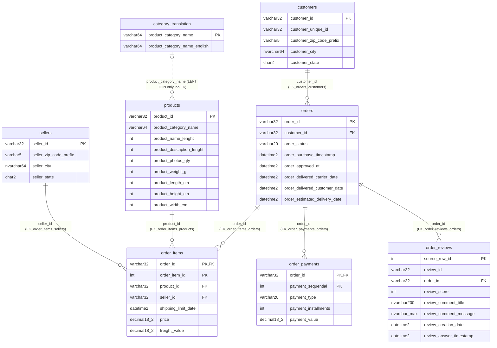

# Schema and Data Dictionary — Olist BI (Track C: Customer Behavior)

**Database:** `OlistBI` (SQL Server 2017+)  
**Layers:** `stg.*` (raw text) → `dbo.*` (typed tables with PK/FK) → `dbo.vw_*` (analysis-ready views)  
**Scripts:** `01_schema.sql` → `02_validation.sql` → `03_analysis.sql` → `04_dashboard_exports.sql`  
**Currency:** BRL (Brazilian real). **Time:** local timestamps as given in the source, no time-zone conversion.

---

## 1. ER diagram (matches the implemented constraints)

**Key relationship notes**

- `customer_id` is **per order** (one customer_id ≈ one order). The **person** is `customer_unique_id`: 99,441 customer_id values map to 96,096 people. All "people" metrics use `DISTINCT customer_unique_id`.
- `order_items.order_item_id` is the **sequence number of the line inside an order**, not a quantity.
- `order_reviews.review_id` is **not unique** (814 duplicates in the source) → the PK is `source_row_id` (row position in the CSV). Some orders have 2–3 reviews (547 orders), so one review per order is chosen in `vw_order_review`.
- No FK from `products` to `category_translation`: 610 products have no category and 13 have an untranslated one. The link is a `LEFT JOIN` so no rows are lost.
- Zip-code prefixes are kept as `VARCHAR(5)` (leading zeros matter). Customers and sellers are not joined by zip code (no geolocation table is used).

---

## 2. Table row grains and source row counts

| Table | Grain (one row per …) | Primary key | Rows |
|---|---|---|---|
| `dbo.customers` | customer_id (an order-level customer record) | `customer_id` | 99,441 |
| `dbo.orders` | order | `order_id` | 99,441 |
| `dbo.order_items` | item line within an order | `(order_id, order_item_id)` | 112,650 |
| `dbo.order_payments` | payment record within an order | `(order_id, payment_sequential)` | 103,886 |
| `dbo.order_reviews` | source review row | `source_row_id` | 99,224 |
| `dbo.products` | product | `product_id` | 32,951 |
| `dbo.sellers` | seller | `seller_id` | 3,095 |
| `dbo.category_translation` | Portuguese category name | `product_category_name` | 71 |

Staging tables `stg.*` have the same names and columns, all `NVARCHAR` (raw copy of the CSV files). `stg.order_reviews` adds `source_row_id` (IDENTITY) to remember the file position.

---

## 3. Source field definitions

### customers
| Field | Type | Definition |
|---|---|---|
| customer_id | VARCHAR(32) | Key used by `orders`. Identifies the customer record of one order. |
| customer_unique_id | VARCHAR(32) | The real person. Used for all customer counts (repeat buyers, value groups). |
| customer_zip_code_prefix | VARCHAR(5) | First 5 digits of the customer's zip code. |
| customer_city | NVARCHAR(64) | City name. |
| customer_state | CHAR(2) | Brazilian state code (e.g. SP). |

### orders
| Field | Type | Definition |
|---|---|---|
| order_id | VARCHAR(32) | Order key. |
| customer_id | VARCHAR(32) | Links to `customers`. |
| order_status | VARCHAR(20) | delivered, shipped, unavailable, canceled, processing, invoiced, created, approved. |
| order_purchase_timestamp | DATETIME2(0) | When the customer placed the order. Used for the analysis window. |
| order_approved_at | DATETIME2(0) | Payment approval time. |
| order_delivered_carrier_date | DATETIME2(0) | Handed to the carrier. |
| order_delivered_customer_date | DATETIME2(0) | Received by the customer (NULL if not delivered). |
| order_estimated_delivery_date | DATETIME2(0) | Delivery date promised to the customer. |

### order_items
| Field | Type | Unit | Definition |
|---|---|---|---|
| order_id | VARCHAR(32) | – | Parent order. |
| order_item_id | INT | sequence | Position of the item line in the order (1, 2, 3…). |
| product_id | VARCHAR(32) | – | Product sold. |
| seller_id | VARCHAR(32) | – | Seller who fulfilled the item. |
| shipping_limit_date | DATETIME2(0) | – | Seller's deadline to hand the item to the carrier. |
| price | DECIMAL(18,2) | BRL | Item price, **excluding** freight. |
| freight_value | DECIMAL(18,2) | BRL | Freight charged for this item line. |

### order_payments
| Field | Type | Unit | Definition |
|---|---|---|---|
| order_id | VARCHAR(32) | – | Parent order. |
| payment_sequential | INT | sequence | Order of the payment record when an order is paid with several methods. |
| payment_type | VARCHAR(20) | – | credit_card, boleto, voucher, debit_card, not_defined. |
| payment_installments | INT | count | Number of installments chosen. **Never multiplied** into amounts. |
| payment_value | DECIMAL(18,2) | BRL | Amount paid in this record. |

### order_reviews
| Field | Type | Unit | Definition |
|---|---|---|---|
| source_row_id | INT | – | Position of the row in the CSV (added by us; tie-breaker). |
| review_id | VARCHAR(32) | – | Review identifier (not unique). |
| order_id | VARCHAR(32) | – | Reviewed order. |
| review_score | INT | 1–5 | Satisfaction score. Values outside 1–5 are invalid. |
| review_comment_title / _message | NVARCHAR | text | Optional comment. Blank → NULL; emoji-only comments are kept. |
| review_creation_date | DATETIME2(0) | – | When the survey was sent. |
| review_answer_timestamp | DATETIME2(0) | – | When the customer answered. |

### products
| Field | Type | Unit | Definition |
|---|---|---|---|
| product_id | VARCHAR(32) | – | Product key. |
| product_category_name | VARCHAR(64) | – | Category in Portuguese (NULL for 610 products). |
| product_name_lenght | INT | characters | Length of product name (source spelling "lenght" kept). |
| product_description_lenght | INT | characters | Length of product description. |
| product_photos_qty | INT | count | Number of photos. |
| product_weight_g | INT | grams | Weight (0 for 4 products). |
| product_length_cm / height_cm / width_cm | INT | cm | Package dimensions. |

### sellers
| Field | Type | Definition |
|---|---|---|
| seller_id | VARCHAR(32) | Seller key. |
| seller_zip_code_prefix | VARCHAR(5) | First 5 digits of the seller's zip code. |
| seller_city | NVARCHAR(64) | Seller city. |
| seller_state | CHAR(2) | Seller state code. |

### category_translation
| Field | Type | Definition |
|---|---|---|
| product_category_name | VARCHAR(64) | Portuguese category name. |
| product_category_name_english | VARCHAR(64) | English name. |

---

## 4. Calculated fields (analysis views)

**Global rules:** window = purchase date `2017-01-01 <= d < 2018-09-01`; population = `order_status = 'delivered'` unless stated; money = BRL; people = `DISTINCT customer_unique_id`; divisions use `NULLIF(denominator, 0)`.

| View | Grain | Population | Script |
|---|---|---|---|
| `vw_orders_in_scope` | order | all statuses in window (99,092) | 02 |
| `vw_delivered_orders` | order | delivered in window (96,211) | 02 |
| `vw_order_items` | item line of a delivered order | 109,880 rows | 02 |
| `vw_order_values` | delivered order | 96,211 | 02 |
| `vw_order_payments` | order | every order with a payment | 02 |
| `vw_order_review` | order | every order with a valid review (98,673) | 02 |
| `vw_customer_summary` | person (`customer_unique_id`) | people with a delivered order (93,104) | 03 |

| Calculated field | View | Formula / rule | Unit |
|---|---|---|---|
| purchase_date | vw_orders_in_scope | `CAST(order_purchase_timestamp AS DATE)` | date |
| purchase_month | vw_orders_in_scope | first day of the purchase month | date |
| has_valid_delivery_dates | vw_delivered_orders | 1 if delivered and estimated dates exist and delivered ≥ purchase; else 0 (8 orders in window) | flag |
| delivery_days | vw_delivered_orders | `DATEDIFF(SECOND, purchase_ts, delivered_ts) / 86400.0`; NULL if dates invalid | days (2 dec.) |
| is_late | vw_delivered_orders | 1 if calendar date of delivery > calendar date of estimate | flag |
| delay_days | vw_delivered_orders | `MAX(0, delivered date − estimated date)` in calendar days | days |
| category_name | vw_order_items | English name, else Portuguese name, else `'unknown'` | text |
| category_status | vw_order_items | `translated` / `untranslated` / `missing` | text |
| item_rows, distinct_products, distinct_sellers | vw_order_values | counts over the order's item lines | count |
| merchandise_value | vw_order_values | `SUM(price)` of the order's items (no freight) | BRL |
| freight_total | vw_order_values | `SUM(freight_value)` | BRL |
| payment_records, payment_methods | vw_order_payments | `COUNT(*)`, `COUNT(DISTINCT payment_type)` | count |
| payment_total | vw_order_payments | `SUM(payment_value)` (installments not multiplied) | BRL |
| is_low_rating | vw_order_review | 1 if `review_score <= 2` | flag |
| valid_review_rows | vw_order_review | number of valid (1–5) review rows of the order | count |
| delivered_orders | vw_customer_summary | `COUNT(DISTINCT order_id)` per person | count |
| total_spend | vw_customer_summary | `SUM(merchandise_value)` per person | BRL |
| avg_order_value | vw_customer_summary | `total_spend / NULLIF(delivered_orders, 0)` | BRL |
| first_order_ts / last_order_ts | vw_customer_summary | `MIN` / `MAX` of purchase time | datetime |

**One review per order rule** (`vw_order_review`): among valid scores 1–5, keep the row with the latest `review_answer_timestamp`, then latest `review_creation_date`, then greatest `review_id`, then greatest `source_row_id`. NULL timestamps count as oldest.

**Dashboard metric definitions (computed in Excel from SQL sums and counts):**
- Average order value = merchandise sales / delivered orders
- Repeat share = repeat people / people (`delivered_orders >= 2`)
- Spend per customer = merchandise sales / people

---

## 5. Reconciliation totals (delivered orders in window)

| Measure | Value |
|---|---|
| Delivered orders | 96,211 |
| People (customer_unique_id) | 93,104 |
| Merchandise sales | 13,181,027.13 BRL |
| Freight | 2,192,092.88 BRL |
| Payment total | 15,375,875.44 BRL |
| Average order value | 137.00 BRL |

> These are the expected values documented in the SQL comments (measured with pandas). Before final submission, replace/confirm them with the numbers your SQL Server run actually returned.

---

## 6. Import method (as required by the brief)

`BULK INSERT` with `FORMAT='CSV'`, `FIELDQUOTE='"'`, `FIRSTROW=2`, `CODEPAGE='65001'` (UTF-8), `TABLOCK`.
Row terminator: LF (`0x0a`) for customers, orders, order_items, products, sellers, order_payments; CRLF (`0x0d0a`) for order_reviews and category_translation.
Blank text → NULL (`NULLIF(LTRIM(RTRIM(x)), '')`); invalid numbers/dates → NULL via `TRY_CONVERT`, counted in `02_validation.sql` Part 1-B.
